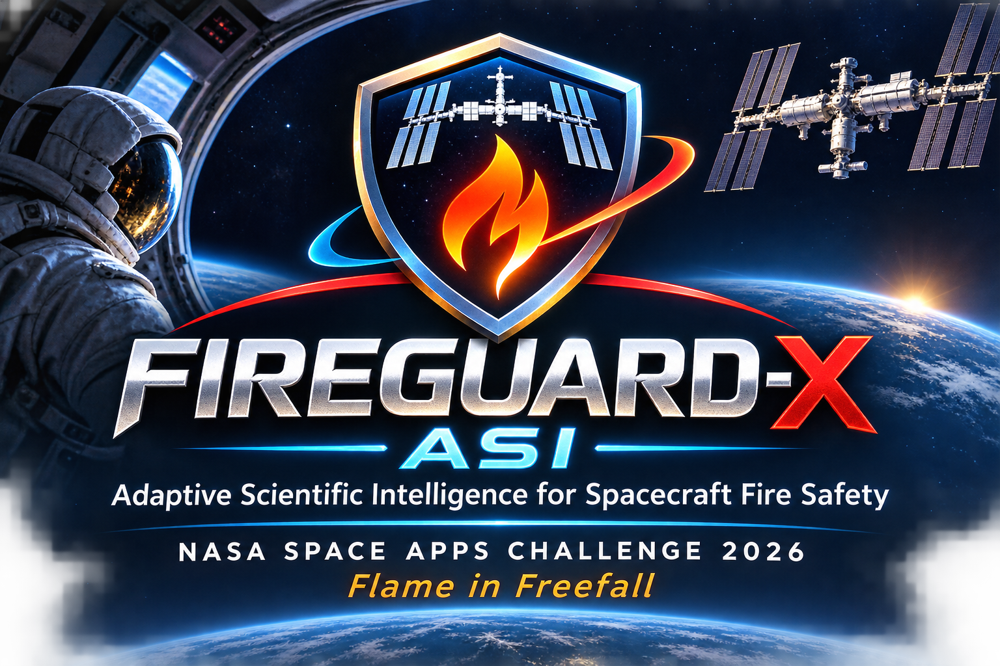

<p align="center">
  
</p>
<h1 align="center">FIREGUARD-X</h1>
<p align="center">
  <strong>Adaptive Scientific Intelligence for Spacecraft Fire Safety</strong><br>
  NASA Space Apps 2026 · <em>Flame in Freefall</em>
</p>
A fire-safety decision-support prototype for crewed spacecraft. It retrieves NASA combustion evidence, estimates fire risk
with a transparent model, has seven specialised agents debate the result, scores how far the answer can be trusted, and
requires a human to approve every action. Every command is **simulated**.

> **Honest labelling.** "ASI" here means *Adaptive Scientific Intelligence*. It is not artificial superintelligence.
> This is an independent prototype, not a NASA product. The risk model and the Trust Score are prototype metrics, not
> NASA-approved. Anything that is not from an ingested NASA document is labelled `SYNTHETIC/DEMO`.

## Run it (Docker)

Requirements: Docker with Compose v2, about 2 GB free disk, internet access for the NASA download.

```bash
cp .env.example .env            # edit passwords/secrets if you wish
mkdir -p data/raw data/processed data/manifests && chmod -R a+rwX data   # the container user must be able to write here
docker compose up --build
```

Open **http://localhost:8080**. Demo logins are shown on the login screen in development mode
(`admin`, `commander`, `analyst`, `viewer`; password from `SEED_PASSWORD`, default `fireguard-demo`).
API docs: http://localhost:8000/api/docs (development mode only).

On first start the `worker` downloads NASA documents from NTRS and `science.nasa.gov` pages (`AUTO_INGEST=true`).
Until that finishes (a few minutes) the app runs on 9 offline `SYNTHETIC/DEMO` passages, clearly marked in every screen.
Watch progress: `docker compose logs -f worker`. Re-run any time from the Evidence screen (admin, "Download official NASA documents") or
`docker compose exec worker python -m app.evidence.cli ingest`.

| Service | Role |
|---|---|
| `frontend` | React + TypeScript dashboard served by nginx (port 8080), proxies `/api` |
| `backend` | FastAPI API (port 8000): evidence, risk, agents, trust, security, audit |
| `db` | PostgreSQL 16 + pgvector (evidence embeddings, audit log, assessments) |
| `redis` | Rate limits and the ingestion job queue (falls back to memory if absent) |
| `worker` | Downloads and indexes NASA documents |

### Real data

* **NASA NTRS** technical reports and **science.nasa.gov** pages for BASS-II, SoFIE, ACME, Saffire and spacecraft fire
  safety. Titles, dates, centres and licences are read from the NTRS record at ingestion, never typed in by hand.
  Every document is stored with its URL, retrieval time, SHA-256 and version, and sealed in `data/manifests/manifest.json`.
* **Other data (optional):** put CSV exports (for example from NASA's Physical Sciences Informatics system) in
  `data/raw/psi/` with columns `variable,value` and optionally `unit,oxygen_percent,airflow_cm_s,pressure_kpa,material,source_reference`.
  They become observations and set the tested envelope; without them the envelope is a labelled prototype assumption.
* **Add a source:** `docker compose exec worker python -m app.evidence.cli add-url https://science.nasa.gov/...` (only `*.nasa.gov` over HTTPS is allowed).
* `EVIDENCE_MODE=strict` makes synthetic evidence unable to produce a TRUSTED result.

## Using it

Nine screens in the left sidebar: Mission command, Fire digital twin, AI council, Evidence explorer, AI debate, Trust center,
Security center, Risk analytics, Audit center. A voice layer (Indian-English speech output and spoken commands, browser
Speech API) speaks alerts and lets you drive the screens: try *"go to trust"*, *"status"*, *"load scenario 3"*.
Recognition needs a Chromium-based browser and microphone permission.

Typical flow: pick a scenario → watch risk and trust update → inspect cited evidence → challenge it in the Security center
(tamper a document, plant a prompt injection) → approve the simulated action as `commander` (two-step confirm) → check the audit chain.

## Develop

```bash
# backend (Python 3.12+)
cd backend && python -m venv .venv && . .venv/bin/activate && pip install -r requirements-dev.txt
pytest -q          # 108 tests: unit, integration, security, evaluation (SQLite, no network)
ruff check app ../tests && mypy app
# frontend (Node 20+)
cd frontend && npm ci && npm run typecheck && npm run lint && npm test && npm run build
npm run dev        # http://localhost:5173, proxies /api to localhost:8000
```

Layout follows the project brief: `frontend/`, `backend/app/{api,agents,security,evidence,rag,risk,simulation,models,services}`,
`data/{raw,processed,manifests}`, `tests/{unit,integration,security,evaluation}`, `docs/`.

## API

`POST /api/evidence/search`, `/api/analysis/run`, `/api/agents/council`, `/api/risk/assess`, `/api/simulation/run`,
`/api/security/validate`, `/api/security/red-team`; `GET /api/evidence/{id}`, `/api/experiments`, `/api/risk/{id}`, `/api/audit`,
`/api/health`; plus auth, approvals, sweeps, heat map, documents, ingestion. Full schema: `docs/openapi.json`; examples: `docs/samples/`.

## Documentation

[Architecture](docs/architecture.md) · [Threat model](docs/threat-model.md) · [Data provenance](docs/data-provenance.md) ·
[AI trust](docs/ai-trust.md) · [Demo script](docs/demo-script.md)

## Known limits

* The risk model is a transparent prototype. Its weights, multipliers and the 13 cm/s airflow peak are assumptions, listed in the app.
* Strict-mode and real-data behaviour depend on what the NTRS download returns on your network; check `docker compose logs worker`.
* Security tests run only against this application. Nothing here attacks external systems.
* Voice recognition quality depends on the browser, microphone and accent.
